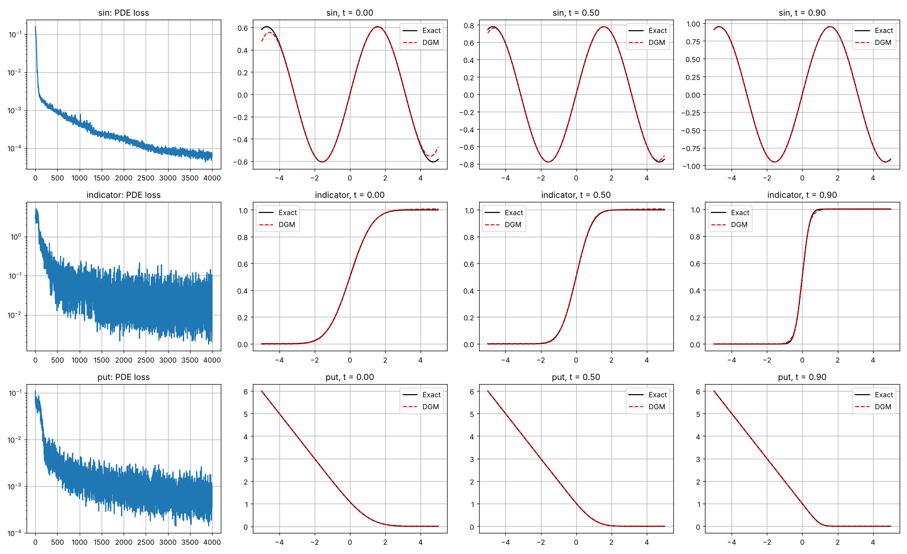
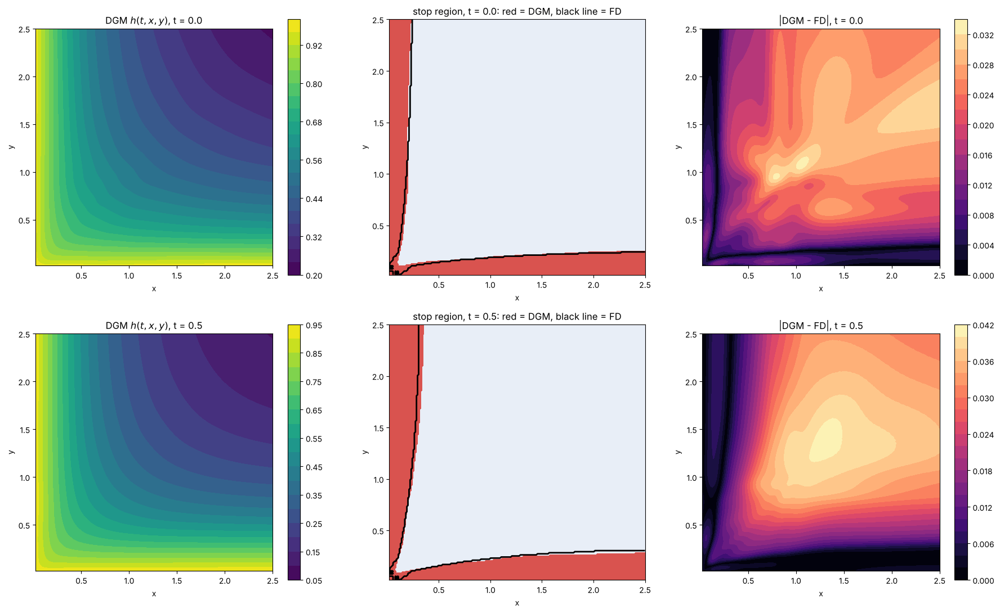
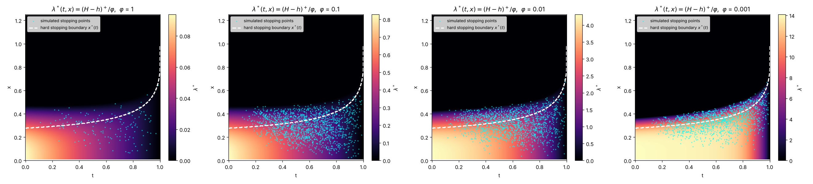

# Deep Galerkin Method for Optimal Stopping and Stochastic Control

> **Status:** Work in progress. ACT496 reading course, *Deep Learning for Stochastic Control*, University of Toronto, Fall 2026. Supervisor: Prof. Sebastian Jaimungal. The final course report is due in December 2026.

## Question

Can a neural network PDE solver, the Deep Galerkin Method (DGM), reliably solve optimal stopping and stochastic control problems? And **how can we tell when it hasn't**?

Every DGM result here is checked against an independent benchmark: a closed-form solution, a finite-difference (FD) solver, or Monte Carlo simulation.

## Key findings

**1. A near-zero loss can hide a wrong answer** ([`01_smoothing_fix`](01_smoothing_fix/))

With the terminal condition built into the network, $`g_\theta = H + (T-t)N_\theta`$, a non-smooth payoff $`H`$ (an indicator, or $`(1-x)_+`$) makes the trivial network $`N_\theta \equiv 0`$ an exact minimiser of the *sampled* loss. Autograd sees $`H'' = 0`$ almost everywhere, and the kink is never sampled. Training reaches a loss of $`2\times10^{-7}`$ while the error against the exact solution stays at 0.4–0.5. Gaussian smoothing of the payoff fixes this, keeps a closed-form solution, and brings the error down to at most 0.015.



**2. Two-dimensional stopping region** ([`02_compound_and_2d_stopping`](02_compound_and_2d_stopping/))

For $`dX = X\,dW_1`$, $`dY = Y\,dW_2`$ (independent) and reward $`(e^{-rt} - \min(X, Y))_+`$, the stopping region is contained in an L-shaped set, $`\{\min(x,y) \le x^*_1(t)\}`$, where $`x^*_1`$ is the one-dimensional boundary. The DGM and FD stop/continue decisions agree on 98–99% of grid points; the largest value error is 0.03–0.04. The same notebook also covers a compound stopping problem, whose reward contains the value function of another stopping problem.



**3. Controlling a jump intensity as a penalised version of optimal stopping** ([`03_jump_intensity_control`](03_jump_intensity_control/))

The agent controls the intensity $`\lambda`$ of a Poisson process, stops at its first jump, and pays $`\tfrac{\varphi}{2}\lambda^2`$ per unit time. The HJB equation is

```math
(\partial_t + \mathcal{L})h + \tfrac{1}{2\varphi}\big((H-h)_+\big)^2 = 0, \qquad \lambda^* = (H-h)_+/\varphi,
```

a quadratic-penalty approximation of optimal stopping. It converges to the optimal stopping value at rate $`\sqrt{\varphi}`$ (deep in the stopping region, $`H - h \approx \sqrt{2\varphi r e^{-rt}}`$). FD, DGM and Monte Carlo (40,000 paths) agree to about $`10^{-3}`$.



## Repository structure

```
01_smoothing_fix/              Heat equation with non-smooth terminal conditions: the failure and the fix
02_compound_and_2d_stopping/   Compound stopping (1-D) and two-dimensional stopping, DGM vs FD
03_jump_intensity_control/     Jump-intensity control: FD, Monte Carlo and DGM
figures/                       Figures used in this README
```

## How to run

```bash
pip install -r requirements.txt
```

- `01_smoothing_fix/01_smoothing_fix.ipynb`: run in Jupyter, about 2 minutes on CPU.
- `02_compound_and_2d_stopping/compound_and_2d_stopping.ipynb`: view only. It is saved with all outputs and figures. It imports a finite-difference helper module (`fd_ref.py`) that was not kept, so it cannot be re-run as is.
- `03_jump_intensity_control/`:
  ```bash
  python step1_fd.py        # FD solutions, about 15 s
  python step2_sim.py       # heat map of lambda* and Monte Carlo check, about 25 s
  python step3_dgm.py 8000  # DGM, 8000 iterations per phi, several minutes
  ```

Random seeds are fixed in every script.

## My role and use of AI

This was a reading course focused on understanding these methods. As permitted by my supervisor, the code, derivations and first-pass analyses in this repository were produced with AI assistance (Claude). My part was to:

- work through every derivation by hand,
- compare the DGM results with the finite-difference, closed-form and Monte Carlo benchmarks, and interpret where and why they disagree,
- present the results to my supervisor each week and answer his questions.

The written course report was co-authored with two classmates and is not included here.
